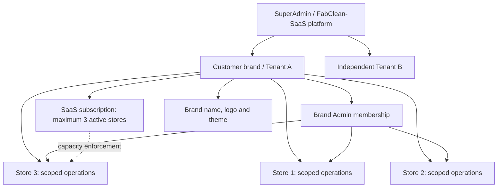

# Tenant, subscription, store and branding requirements

Date: 5 November 2026. Status: proposed design documenting the user's requirements; implementation is not authorized by this document. Application code, live data, branding and configuration remain unchanged.

Read with [the source audit](TENANT_MANAGEMENT_AUDIT.md) and [DD-002](DESIGN_DECISIONS.md#dd-002--brand-as-tenant-with-licensed-stores-and-delegated-branding). Existing capabilities must be reused where suitable; the proposed screens and policies below are not claims of delivered behavior.

## 1. Business scenario and vocabulary

A customer subscribes to FabClean-SaaS for one brand and up to three stores. The SuperAdmin creates the brand, assigns a three-store entitlement, configures its initial identity and branding, and invites its Brand Admin. The Brand Admin completes the brand/store configuration and manages stores within that allocation. Other brands cannot access its operational data.

| Term | Meaning |
| --- | --- |
| Platform | The FabClean-SaaS service administered by the SuperAdmin. |
| Tenant / Brand | One subscribed customer business and its isolation boundary. “Tenant” is platform terminology; customer screens use “Brand.” |
| Store | An operating location belonging to exactly one brand. |
| Brand Admin | A customer administrator with authority over its brand and permitted stores, not other tenants. |
| Store Manager / Staff | Users with explicitly assigned store access and capabilities. |
| SaaS subscription | The brand's access to FabClean-SaaS, licensed capacity and platform features. |
| Customer subscription | A laundry customer's service package/recurring order agreement inside a store; unrelated to the brand's SaaS subscription. |

Starting scope: one subscription covers one brand; a person can have separately authorized memberships in multiple brands. A customer-account/contact reference may be global platform billing metadata, but must not grant cross-brand data access. A parent organization sharing a contract across several brands is a future extension requiring its own design decision.

## 2. Required authority and boundaries

| Action | SuperAdmin | Brand Admin | Store Manager / Staff |
| --- | --- | --- | --- |
| Create a tenant; set canonical brand name/slug/legal identity | Yes | Request change; no platform identity changes | No |
| Assign plan, store capacity, licensed features and subscription status | Yes | View own allocation; request upgrade | No |
| Configure logo/theme | Any selected brand; set defaults and editing policy | Own brand when permitted; enabled by default | Inherit brand; no brand-wide changes |
| Create/configure/reactivate stores | Within the allocated tenant policy; change allocation separately | Own brand, within capacity | Operational settings only where explicitly granted; no store allocation |
| Invite/manage Brand Admins | Yes, audited | Optional delegation permission; no escalation beyond own scope | No |
| Manage store staff | Explicit tenant scope | Own-brand memberships and assigned stores | Only delegated store permissions, if enabled |
| Configure services, prices, tax settings, schedules and hardware | Explicit tenant/store context | Own brand defaults and store settings | Authorized store configuration only |
| View operations and reports | Explicit audited operational context; no implicit global operational query | Selected store operations; authorized brand reports | Assigned-store operations/reports only |
| Access another brand's data | Separate explicit privileged workflow | Never | Never |

Changing a name, logo, theme or selected store must never change ownership or permissions. Do not infer access from a shared email domain, brand slug, URL, color, browser preference or caller-provided tenant ID.

## 3. SuperAdmin user experience

**Tenant directory:** search/filter by brand name, tenant ID, owner, subscription state and capacity. Each row shows logo, brand name, owner-invitation state, subscribed package and “2 of 3 stores used.” Include clear actions: Manage tenant, Branding, Stores, Access, Subscription and Audit. Avoid an unbounded row of buttons as the primary tenant picker.

**Create tenant wizard:** Customer/contact → Brand identity → Package and capacity → Initial stores → Brand Admin invitation → Review and create. Provide an explicit field “Maximum active stores: 3.” Show included features, billing-management mode and initial branding preview. Do not silently choose unlimited capacity. Permit an initial store and later completion of remaining slots; creating three immediately is optional, not a requirement.

**Tenant detail:** Overview, Stores, Users & Access, Branding, Subscription & Limits, and Audit tabs. Keep the tenant name and ID visible. Show both allocated capacity and current usage, active/inactive stores, onboarding progress and unresolved configuration. Store creation is available when capacity remains, including after the first store already exists.

**Platform versus store operations:** a management selection does not silently change an operational session. “Open tenant operations” explicitly selects an authorized store, warns about unsaved work and records privileged entry. Returning to platform management restores its neutral platform identity.

**Review changes:** show old/new values, affected brand/stores, inherited values, locks and applicable dates before saving shared settings, capacity, lifecycle or branding. Require a reason for support overrides/suspension and retain audit history. Invitation links are single-use and expiring; token values are not placed in audit logs.

## 4. Brand Admin user experience

On first sign-in, show “Welcome to [Brand]” and a checklist: confirm profile, upload logo/choose theme, set up stores, invite staff, configure services/prices and test workflows. Show “1 of 3 stores active; 2 available.”

The brand workspace provides Stores, Brand defaults, Branding, Team and Reports. Brand Admin sees only its authorized brands; store staff see only assigned stores. Display “Brand: CleanAndDry · Store: Schaumburg” persistently. Use a searchable picker when needed, with a confirmation when switching would discard unsaved work. An explicit “All stores” report filter must not become the active write scope for orders.

The Stores page supports create, edit, deactivate and reactivate within allocation. The configuration editor clearly labels “Applies to all inheriting stores” versus “This store only,” shows effective values and their source, and offers deliberate Reset to brand default actions. Configuration authority never allows enabling features excluded by the platform package.

At capacity, show “3 of 3 stores used. Contact the platform administrator to increase your limit.” Offer Request upgrade rather than a failing save as the normal flow. The backend still enforces the same limit for direct API calls and concurrent requests.

## 5. Three-store subscription and quota rules

- Capacity is a server-owned entitlement of the brand, configurable by SuperAdmin through a package or explicit brand override. Brand Admin cannot change it through settings, membership edits or forged requests.
- Proposed counting policy follows current behavior: count active operating stores; inactive stores retain their records and do not consume an active slot. Explain this visibly. A store with open work/dependencies must satisfy safe deactivation rules before freeing a slot.
- Each store has a stable ID and a brand-unique store code. Renaming/deactivating does not recycle another store's identity or move its records. Cross-brand store moves are out of scope.
- Create/reactivate operations must atomically lock/check capacity and persist the store. With two active stores and two concurrent additions, exactly one may activate; the other receives a capacity conflict without partial records.
- Decreasing capacity below current active usage is rejected with a remediation list. Do not delete stores, silently deactivate them or select winners automatically. Upgrades become effective according to the documented subscription change policy.
- Editing a shared plan must preview every affected tenant. Individual contractual exceptions must remain explicit and audited; a per-brand limit change must not modify other brands' plans.
- Do not assume a capacity allocation collects money. Initial commercial operation may be manually administered; automatic recurring collection requires a separately selected billing provider and implementation scope.

### Proposed SaaS subscription record and lifecycle

Document separately from `customer_subscriptions`: tenant/brand reference, package/version, effective feature and capacity allocation, commercial status, billing contact, start/end/renewal dates, currency, billing mode, optional provider references, and audited changes. Billing references and provider events must resolve to the authoritative tenant; idempotent processing must not accept a client-selected tenant as proof.

Proposed commercial states are Pending activation, Trial, Active, Past due, Suspended and Cancelled. Map each to explicit operation/export access and jobs behavior before implementation. Pending activation grants onboarding access only; Active allows licensed operations; suspension blocks new operational work and prevents jobs from continuing writes, while preserving data. Cancellation never means immediate deletion. Grace periods, read-only/export windows, retention, recovery and cancellation timing are commercial decisions to finalize before automated enforcement. Existing active/suspended brand state must remain the effective control until a reviewed migration provides an explicit mapping.

## 6. Brand identity, logo and color themes

**Ownership:** the SuperAdmin can create/update canonical brand names and configure initial logos/colors for every tenant. Brand Admin can manage its own logo and app theme by default. SuperAdmin may explicitly lock branding fields or require a change request for a managed brand; the UI explains who controls each field. Neither a Brand Admin nor a store manager can change the platform identity or another brand's branding.

**Fields:** canonical brand name, legal name (if different), unique slug, logo asset reference, optional light/dark logo variants, theme preset or custom validated palette, accessible text colors, revision, update actor/date, and editing policy. Use one effective branding model rather than divergent values in `brands.logo_url`, business-name settings and theme preferences. Document compatibility precedence before migration.

**Theme editor:** preserve the existing presets; propose optional primary/accent/background choices with derived accessible text and semantic status colors. Validate supported color formats, contrast (WCAG AA targets), and mobile readability. No arbitrary CSS, HTML or executable theme content. Preview header, navigation, service cards, form controls, invoice/receipt and mobile layout; Save, Cancel and Reset are explicit. Unsaved previews are local and do not update other sessions.

**Logo workflow:** upload, preview/crop within supported constraints, replace and remove with a brand-name fallback. Proposed initial formats PNG/JPEG/WebP, maximum 2 MB and maximum 2048×2048 decoded pixels; reject executable/SVG content initially, malformed images, oversized decoding and mismatched MIME/extension. These are proposed limits, not existing configuration. Store generated asset keys under immutable tenant IDs, not display names; only authorized tenant editors can replace/delete them. Do not fetch arbitrary remote logo URLs without a separate safe-fetch design.

Public display logos may be deliberately publicly readable; that exception does not apply to private order photos or customer documents. A branding asset URL must not authorize access to a private asset. Asset cleanup must not break saved historical receipt/document references.

**Inheritance:** platform fallback → brand branding → explicitly permitted store presentation overrides. By default all three stores share the brand logo/theme; store contact/address fields remain store-specific. Store identity overrides require Brand Admin permission, are visibly labelled, and cannot change the tenant boundary. Subscription/permission restrictions are not overridable branding settings.

**Surfaces:** in-app header/navigation, tenant/store switcher, sign-in/invitation context where appropriate, order summaries, receipts, printable tags, exports and notification templates. Printed monochrome labels remain legible. Preserve the original identity in immutable financial/document snapshots where required; do not rewrite past invoices when a brand renames itself.

**Consistency:** updates use revision checks, audit old/new values, invalidate tenant-specific caches and apply on context refresh. Switching tenants clears stale logos/themes and outstanding responses before showing the new context. Platform administration always retains platform branding. A public branded sign-in page, if added, exposes only intentionally public identity; it must not expose owners, subscription details, user lists or operational data.

## 7. Tenant and store data separation

Retain shared PostgreSQL with a shared schema and forced RLS. Tenant = existing `brand_id`; legacy operational `business_id` maps to that tenant, and `location_id` maps to `store_id`. Use these mappings consistently without immediately renaming database columns.

| Data category | Default separation |
| --- | --- |
| Brand identity, subscription allocation, branding and shared templates | One brand; authorized brand administration only. |
| Customers, orders, garments, payments/refunds, tax policies, inspection/photos, loyalty and recurring customer services | Brand + store. Customers do not become brand-shared automatically. |
| Reports | Selected store, or explicitly authorized aggregation of stores in the same brand. |
| Handoffs | Explicit participating stores within one brand, with existing custody permissions. |
| Authentication | Global identity with scoped memberships; a global identity is not a global customer-data permission. |
| Support/audit | Control-plane metadata restricted to the platform; operational access requires explicit tenant/store context and audit. |

For each table, document ownership, uniqueness scope, parents, read/write/delete policy, retention and migration. Cross-record links require compatible tenant/store ownership, preferably enforced by composite foreign keys as well as API validation. Any global exception must be named and justified.

Authentication determines accessible memberships; context selection is validated against them. Clients cannot grant access by changing tenant/store headers or embedding ownership in payloads. Missing scope fails closed. Reused connections and background jobs must not inherit a previous request's scope. Never add a normal HTTP option to enable maintenance or bypass RLS.

Apply equivalent boundaries to search, dashboards, CSV/export, image/download routes, caches, browser storage, notifications, provider events and jobs. Cache/idempotency keys include authoritative scope as needed. Snapshot queued job ownership and recheck status/permission before execution. Refused foreign access must not disclose names, counts or financial metadata through error messages.

Deactivation and subscription cancellation preserve financial history. Any tenant data export/deletion/restore needs a scoped, audited workflow and an explicit retention/recovery policy. Shared-database backups restore infrastructure, not automatically an individual tenant; tenant-specific recovery needs a separate reconciliation design.

## 8. Acceptance scenarios for future implementation

| ID | Scenario and required result |
| --- | --- |
| TM-01 | SuperAdmin creates Brand A with maximum 3 active stores and invites its Brand Admin; review shows correct identity, capacity and editable branding policy. |
| TM-02 | Brand Admin accepts invitation, configures logo/theme and sets up stores A1/A2/A3 without SuperAdmin permissions. |
| TM-03 | Fourth activation fails in UI and direct API; concurrent creation with one slot remaining yields one success and one conflict. |
| TM-04 | Safe deactivation frees a slot; reactivation at capacity is rejected; history and ownership remain intact. |
| TM-05 | Brand B with separate stores cannot list/search/read/change/export A's records, photos, logos' editing controls, memberships, templates, audit or jobs. |
| TM-06 | Store A1 staff cannot operate A2 or A3 without assignment; Brand Admin can manage A's stores and explicitly aggregate A-only reports. |
| TM-07 | Same local customer/barcode/service identifiers across tenants resolve only in the authorized context; foreign related IDs fail with no side effects. |
| TM-08 | SuperAdmin sets brand name/colors/logo and editing permissions; permitted Brand Admin edits own logo/theme; store staff and foreign admins are denied. |
| TM-09 | Brand/theme updates propagate to all inheriting stores; explicit allowed overrides remain, Reset restores inheritance, stale editors conflict. |
| TM-10 | Invalid/oversized logos and inaccessible palettes are rejected; branding reset/fallback, narrow screens, printing and tenant switching remain readable and correctly scoped. |
| TM-11 | Changing shared plans previews affected brands; downgrades below usage fail; unauthorized users cannot increase capacity or enable unlicensed features. |
| TM-12 | Invitations expire/revoke/single-use safely; reused identities do not gain unintended memberships; role removal/suspension invalidates access and relevant jobs. |
| TM-13 | Subscription administration does not alter laundry-customer subscriptions, past invoices, saved tax/currency, payment ledgers or unrelated brands. |
| TM-14 | Replay provider/job events, switch context during requests, reuse database connections and retry exports; no cross-tenant leakage or duplicate billing/work. |
| TM-15 | Repeat migration, restore compatible previous application version and reconcile per-tenant counts/financial totals; ambiguous historical ownership is quarantined, never guessed. |

Run real PostgreSQL tests with a NOSUPERUSER NOBYPASSRLS application role, negative authorization checks and both desktop/mobile UI workflows. Include SQL-level RLS tests, not only UI hiding. A source audit or passing old test run does not establish these new scenarios as passed.

## 9. Proposed feature groups and delivery order

| Group | Documented features | Dependencies |
| --- | --- | --- |
| A — Boundaries and vocabulary | Complete table/endpoint/job inventory; control-plane versus operations review; normalized ownership terminology and explicit exceptions. | This source audit; no wholesale isolation rewrite. |
| B — Tenant onboarding and stores | Tenant directory/detail tabs, guided provisioning, owner invitation, 3-store usage display, upgrades and capacity error recovery. | A; reuse existing platform plans and store locking. |
| C — Branding | SuperAdmin/Brand Admin editors, permissions/locks, safe logo assets, preset/custom palette previews, inheritance and propagation. | A/B; agreed branding precedence and asset policy. |
| D — Configuration workspace | Brand defaults versus store overrides, team roles and understandable active-context navigation. | A/B; retain existing configuration semantics. |
| E — SaaS commercial lifecycle | Separate subscription record, manual administration first, explicit dates/state-to-access mapping; provider billing only if separately selected. | Agreed commercial rules; not customer subscriptions. |
| F — Acceptance and rollout | Tenant-isolation regression suite, migration rehearsal, UI usability review and staged release evidence. | Each group must meet its own applicable acceptance checks before release. |

Implement one scoped change at a time after separate authorization; do not assign speculative GitHub PR numbers or treat this list as permission to merge/deploy.

## 10. Decision rationale, migration and unresolved policy

Reuse the existing brand boundary and store quotas because they already match the stated one-brand/three-store scenario. Do not introduce a parent-organization hierarchy, a database per tenant or a second authorization system without a demonstrated requirement. Branding is presentation metadata, not a security boundary. Prefer delegation with explicit locks over making the SuperAdmin perform every routine customer branding edit.

Before any implementation, inventory old names/logo/theme sources and resolve precedence, preserve stable IDs, snapshot history and quota overrides, back up data, define additive migration/version compatibility and rehearse rollback. Do not assign unowned rows to the logged-in brand. New billing integrations need separate secret storage, webhook verification and provider/account reconciliation; no credentials belong in these documents.

Outstanding decisions to confirm before their dependent features: whether capacity counts active stores (recommended) or all provisioned stores; whether store-level identity overrides are allowed; custom palettes versus presets-only rollout; subscription fees/provider/trial/grace/retention rules; and any requirement for one commercial organization to own multiple brands. The defaults proposed above permit documenting the scenario now without pretending these product choices are already implemented or approved.
